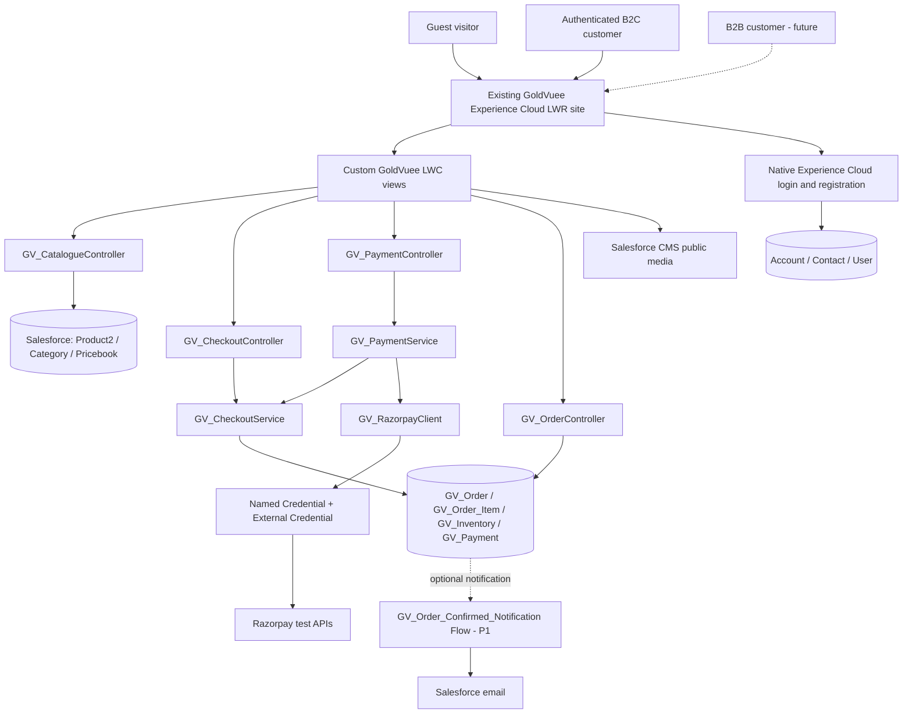

# 02 — GoldVuee System Architecture (Canonical Single Source of Truth)

**Document control:** GV-DOC-02 | v1.0 | 2026-11-04 | **Authoritative names, ownership, state transitions, architectural decisions**. Status: planned; configuration reported by owner but not independently inspected.

> **Change control:** Every change to an object/API name, flow name, Apex method contract, source-of-truth rule or order/payment state begins here and is propagated to documents 01 and 03–13 in the same Git commit. Never silently rename a component in a downstream document.

## 1. Architecture at a glance



| Layer | MVP mechanism | Responsibility | Trust boundary |
|---|---|---|---|
| Experience Cloud | Existing LWR site | Pages, site navigation, native authentication | Guest vs authenticated routes |
| LWC | `goldVuee*` components | Presentation, local cart, form validation, request states | Never validate price/payment as authoritative |
| Public Apex | `GV_CatalogueController` | Limited public product/category DTOs | Public fields + published flag + user-mode access |
| Customer Apex | `GV_CheckoutController`, `GV_PaymentController`, `GV_OrderController` | Identity checks, checkout orchestration, history | Current `User.ContactId`, not client Contact Id |
| Domain Apex | `GV_CheckoutService`, `GV_PaymentService`, `GV_RazorpayClient` | Reprice, lock stock, create order, verify gateway, idempotency | Narrow justified elevated DML access |
| Database | Salesforce standard + 5 custom MVP objects | Source of truth and transactional writes | Private objects, CRUD/FLS, unique constraints |
| Media | Salesforce CMS public channel; fallback verified public asset strategy | Public product images | No private Files exposed to guest |
| Payments | Razorpay test environment | Payment attempt/capture | Gateway authoritative; no frontend-only confirmation |
| Automation | One optional Flow, none required for atomic transaction | Confirmation email only | Never owns stock/payment transition |

## 2. Naming registry — exact names

**Standard objects:** `Account`, `Contact`, `User`, `Product2`, `Pricebook2`, `PricebookEntry`.

**MVP custom objects:** `GV_Category__c`, `GV_Inventory__c`, `GV_Order__c`, `GV_Order_Item__c`, `GV_Payment__c`. **P2 only:** `GV_Wishlist_Item__c`, `GV_Inventory_Movement__c`. No separate Order/OrderItem and GV_Order model together, no MVP Cart objects.

**MVP LWC:** `goldVueeHeader`, `goldVueeHome`, `goldVueeCatalogue`, `goldVueeProductCard`, `goldVueeProductDetail`, `goldVueeCart`, `goldVueeCheckout`, `goldVueeOrderConfirmation`, `goldVueeMyOrders`. **P1:** `goldVueeProfile`. **P2:** `goldVueeWishlist`.

**MVP Apex:**

| Apex class | Authoritative public/internal method signatures (conceptual Apex; exact DTO shape in Doc 06) |
|---|---|
| `GV_CatalogueController` | `getCategories(String audience)`; `getProducts(String audience, Id categoryId, String searchText, String sortBy, Integer pageNumber)`; `getProduct(Id productId)` |
| `GV_CheckoutController` | `createPendingOrder(String checkoutJson)` |
| `GV_PaymentController` | `startPayment(Id orderId)`; `verifyPayment(Id orderId, Id paymentAttemptId, String razorpayPaymentId, String razorpaySignature)` |
| `GV_OrderController` | `getMyOrders()`; `getMyOrder(Id orderId)` |
| `GV_CheckoutService` | `createPendingOrder(Id contactId, List<CheckoutLineDTO> lines, AddressDTO address)`; `confirmCapturedPayment(Id orderId, Id paymentAttemptId, GatewayPaymentDTO payment)` |
| `GV_PaymentService` | `startPayment(Id contactId, Id orderId)`; `verifyPayment(Id contactId, Id orderId, Id paymentAttemptId, String razorpayPaymentId, String signature)` |
| `GV_RazorpayClient` | `createOrder(Long amountPaise, String receipt)`; `fetchPayment(String razorpayPaymentId)` |

**Flow API name:** `GV_Order_Confirmed_Notification` (**P1 optional**), after-save Record-Triggered Flow on `GV_Order__c`. **MVP triggers:** none. **REST endpoint:** no unauthenticated custom Apex REST endpoint in MVP. **Named Credential:** `GV_Razorpay_Test`; **External Credential:** `GV_Razorpay_Test_Auth`. **Browser cart key:** `gv_cart_v1` (non-authoritative; no card data).

## 3. Architecture decisions (ADRs)

| ID | Decision | Reason and trade-off | Revisit condition |
|---|---|---|---|
| ADR-01 | Keep existing LWR site | Avoid rework and preserve reported configuration | Existing site fails functionality/security audit |
| ADR-02 | Use `Product2` and `PricebookEntry` | Native product and price management; no custom duplicate catalogue/price object | Multi-price/promotions later |
| ADR-03 | Use custom `GV_Order__c`/`GV_Order_Item__c` instead of standard `Order`/`OrderItem` | Demo ecommerce requires straightforward Pending Payment → Confirmed states, immutable price snapshots, no standard Order activation/process constraints | Future Sales Cloud/ERP integration requires standard Order |
| ADR-04 | One inventory row per SKU; no reservations MVP | Minimize automation but explicitly handle payment/stock race | Paid stock conflicts persist; implement reservations P2 |
| ADR-05 | Local browser cart, authoritative server recalculation | Guest browse and simple UI without guest DML or cart objects | Cross-device persistence P2 |
| ADR-06 | Native Experience Cloud identity | Lower authentication risk than custom login/password LWC | License/site limitation identified |
| ADR-07 | Apex for payment, order and inventory transaction; zero required Flows | Atomicity, row locking, HMAC/provider validation and replay protection | Workflow-only notifications useful P1 |
| ADR-08 | Salesforce CMS public published images; placeholder if CMS not available | Appropriate web content delivery and no external infrastructure | CMS workspace/channel unsupported in org |
| ADR-09 | Direct server verification is required; webhook P2 | Secure without an unprotected guest REST webhook; UI response is not proof | Reliable production reconciliation required |
| ADR-10 | India/INR, one configured price, zero demo tax/shipping | Seven-day test-specific constraints, not a production tax claim | Real commerce adoption |

## 4. Data ownership and invariants

1. `Product2.GV_SKU__c` is globally unique; a product is visible publicly only if `IsActive = true`, `GV_Published__c = true`, category is active and public price exists.
2. Authoritative unit amount is active standard `PricebookEntry.UnitPrice` in the `GoldVuee Retail` `Pricebook2`, not a field from browser/cart.
3. Each `GV_Inventory__c.GV_Product__c` points to exactly one Product2; its `GV_Product_Key__c` equals the Product2 18-character Id and is unique to prevent duplicate stock rows. This key is populated on create and protected from changes; the creation UX/seed script must enforce it.
4. `GV_Order__c` belongs to one `Contact`; server resolves Contact from the logged-in `User.ContactId`. Customer cannot submit another Contact Id.
5. `GV_Order_Item__c` stores name/SKU/unit price/quantity/line total **snapshots**. Later catalogue price changes do not mutate placed orders.
6. Pending order total is derived only from server-priced lines + approved demo shipping/tax rules and saved immutably. Gateway attempt amount equals `round(order.total * 100)` paise and currency `INR`.
7. Each `GV_Payment__c.GV_Razorpay_Order_Id__c` is unique; each nonblank `GV_Razorpay_Payment_Id__c` is unique. Replays are safe.
8. `Confirmed` transition and inventory decrement are in one Salesforce transaction after payment authentication and capture checks. Lock Order and Inventory rows using `FOR UPDATE`; confirm only if not previously confirmed.
9. If captured payment exists but stock is unavailable at confirmation, status becomes `Payment Review` (no inventory below zero), with staff manual resolution. **This is an MVP limitation and release-demo negative test.**
10. Guest users cannot query private Contact, Order, Inventory, Payment, or invoke payment/checkout Apex.

## 5. Checkout sequence and transaction boundaries

```mermaid
sequenceDiagram
  actor User as Signed-in customer
  participant UI as goldVueeCheckout
  participant C as GV_CheckoutController
  participant S as GV_CheckoutService
  participant P as GV_PaymentController / Service
  participant R as GV_RazorpayClient
  participant G as Razorpay Test
  participant DB as Salesforce
  User->>UI: Confirm cart and shipping
  UI->>C: createPendingOrder(checkoutJson)
  C->>S: createPendingOrder(current ContactId, lines, address)
  S->>DB: Read pricebook + inventory, insert Pending Payment order + snapshots
  DB-->>UI: Order Id and canonical amount
  UI->>P: startPayment(orderId)
  P->>R: createOrder(amountPaise, receipt)
  R->>G: POST /v1/orders via Named Credential
  G-->>R: Razorpay orderId
  P->>DB: Insert GV_Payment attempt Created
  P-->>UI: test key ID, attemptId, Razorpay orderId
  UI->>G: Razorpay checkout (public key)
  G-->>UI: payment ID and signature (untrusted input)
  UI->>P: verifyPayment(orderId, attemptId, paymentId, signature)
  P->>R: fetchPayment(paymentId)
  R->>G: GET /v1/payments/:id
  G-->>P: Captured, amount, currency, orderId
  P->>P: Signature HMAC check + compare stored attempt and amount
  P->>S: confirmCapturedPayment(...)
  S->>DB: Lock order/inventory; mark payment captured; decrement stock; confirm order
  DB-->>UI: Confirmed / Payment Review
```

**Important:** creating a Pending Payment order **precedes** gateway payment, whereas creating a *confirmed* sales order follows verification. The two operations are intentionally separate. Do not perform DML and then make an Apex callout in the same synchronous transaction. `startPayment` performs callout **before** recording the attempt. A failed callout leaves the pending order but no attempt; retry creates a fresh gateway attempt, not a fake success.

## 6. Order states and transitions

| From | To | Actor/guard | Stock effect |
|---|---|---|---|
| new | `Pending Payment` | `GV_CheckoutService` after server reprice/stock check | none |
| `Pending Payment` | `Confirmed` | `GV_CheckoutService.confirmCapturedPayment`; verified `captured` gateway state | Decrement quantities exactly once |
| `Pending Payment` | `Payment Review` | Captured but no available stock/integrity failure requiring operator | none |
| `Pending Payment` | `Cancelled` | Order Manager after abandon/expiry; no captured payment | none |
| `Confirmed` | `Processing` | Order Manager | none |
| `Processing` | `Shipped` | Order Manager | none |
| `Shipped` | `Delivered` | Order Manager | none |
| `Confirmed` | `Cancelled` | **P2** policy-driven staff cancellation/refund, not MVP | Compensation required |
| any eligible | `Returned`/`Refunded` | **P2** separate flow with settlement checks | Controlled reversal only |

Payment attempt statuses: `Created`, `Captured`, `Failed`, `Review` (P0); `Refunded` (P2). UI browser close leaves Pending Payment; never pretend paid. Attempt failure does not change a previously Confirmed order. **No automatic inventory increment on Failed payment** (nothing was deducted).

## 7. Responsibility matrix — which Salesforce component does what?

| Function | UI | Backend / core records | Business rule owner |
|---|---|---|---|
| Collections and search | `goldVueeHeader`, `goldVueeCatalogue` | `GV_CatalogueController`, Product2/Category/Pricebook | Catalogue Apex filters + sharing |
| Product detail/images | `goldVueeProductDetail` | Catalogue Apex + CMS | Public visibility rules |
| Auth | Native Experience Cloud pages | User/Contact/Account, site memberships | Salesforce standard identity settings |
| Cart | `goldVueeCart` (`gv_cart_v1`) | No server cart records MVP | `GV_CheckoutService` reprices/rechecks |
| Place pending order | `goldVueeCheckout` | CheckoutController/Service, Order/Items | CheckoutService |
| Payment | Razorpay checkout UI | PaymentController/Service, RazorpayClient, Payment | PaymentService |
| Stock | Availability display | Inventory + CheckoutService row locks | CheckoutService |
| My orders | `goldVueeMyOrders` | OrderController + private Order | OrderController identity checks |
| Staff product, stock, orders | Standard Lightning pages | Standard UI; permission sets | Managers and admin |
| Email | Native email, optional Flow P1 | `GV_Order_Confirmed_Notification` | Flow (non-transactional notification only) |

## 8. Boundaries, risks and gates

- **External license/registration:** self-registration is only configured, not confirmed; test User.ContactId, self-register rate-limiting/bot protection, site membership and forgot password on Day 1/4.
- **Shared Account concern:** a shared parent Account can over-share Contact and business data. Security proof with two distinct logins is a blocker, not a nice-to-have.
- **Guest Product2 sharing:** test actual object CRUD/FLS and guest criteria-based record access in this specific org. Never solve a failed catalogue query by granting `View All`, removing row filters or publishing inventory/customer data.
- **CMS and checkout.js:** validate edition-specific CMS delivery and Experience Cloud LWR CSP/Lightning Web Security behavior on Day 2 and Day 6. No unapproved script injection.
- **Secret accessibility:** Named Credentials safely authenticate Razorpay API callouts, but **Apex does not automatically get a readable secret for HMAC computation**. An additional tightly restricted test-only secret arrangement is required if implementing callback-signature HMAC in Apex. Do **not** commit it, place it in LWC, or claim it is production-grade; see Doc 08. Shipping live is blocked until an approved secret solution and webhook/reconciliation design exist.
- **Stock paid-after-sold scenario:** no inventory reservation → captured payments may require manual `Payment Review`. The project must show how it detects rather than ignores this case.

## 9. Official platform references

Salesforce security/user-mode: https://developer.salesforce.com/docs/platform/apex-dev/references/apex-dev/apex-classes-enforce-usermode.html  
Guest sharing: https://help.salesforce.com/s/articleView?id=platform.security_sharing_rules_guest.htm&type=5  
LWR CSP: https://developer.salesforce.com/docs/platform/communities-dev/guide/communities-dev-security-locker-csp.html  
Salesforce CMS and LWR: https://help.salesforce.com/s/articleView?id=experience.networks_data_binding_images.htm&type=5  
Named Credentials: https://developer.salesforce.com/docs/platform/apex-dev/references/apex-dev/apex-callouts-named-credentials.html  
Razorpay integration/signature: https://razorpay.com/docs/payments/payment-gateway/web-integration/standard/integration-steps/

**Next:** [Field dictionary and ERD](03_DATA_MODEL.md) · [Apex contracts](06_APEX_DOCUMENTATION.md) · [Payments](08_INTEGRATION_DOCUMENTATION.md) · [Testing](11_TESTING_DOCUMENTATION.md)