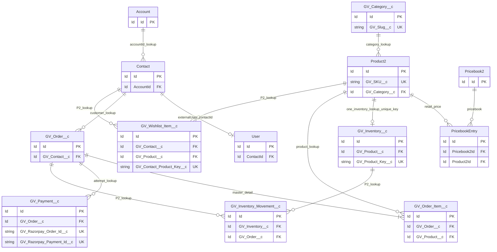

# 03 — GoldVuee Data Model, Object and Field Dictionary

**GV-DOC-03 | v1.0 | 2026-11-04 | Architecture proposal — no new object/field existence verified.** All custom field names below are binding design decisions, controlled by [Doc 02](02_SYSTEM_ARCHITECTURE.md). All lengths/currency values are intended Salesforce Setup configurations; verify available field types and precision in the target Developer Edition before deployment.

## 1. Object selection and priority

| API name | Type | Priority | Why / owner |
|---|---|---|---|
| `Account` | Standard | P0 | Existing GoldVuee Customers Account / future business accounts; Salesforce identity model |
| `Contact` | Standard | P0 | One private customer identity per Experience Cloud user |
| `User` | Standard | P0 | Native authentication; user Contact mapping |
| `Product2` | Standard | P0 | Jewellery master SKU; avoid duplicate custom Product |
| `Pricebook2` | Standard | P0 | `GoldVuee Retail` active price book for INR |
| `PricebookEntry` | Standard | P0 | Per-product price in Retail price book; Standard Price Book setup prerequisite |
| `GV_Category__c` | Custom | P0 | Dynamic collection/category navigation not represented by a suitable simple native Product2 field alone |
| `GV_Inventory__c` | Custom | P0 | One mutable stock count per SKU, not available directly on Product2 |
| `GV_Order__c` | Custom | P0 | Customer-facing Pending Payment/captured order lifecycle tailored to MVP |
| `GV_Order_Item__c` | Custom | P0 | Immutable ordered quantity, SKU, description/price snapshots |
| `GV_Payment__c` | Custom | P0 | Gateway payment attempts, provider unique IDs and reconciliation state |
| `GV_Wishlist_Item__c` | Custom | P2 | Persist one wishlist entry per Contact/Product after MVP |
| `GV_Inventory_Movement__c` | Custom | P2 | Auditable stock movement ledger and reversals after MVP |

**Explicitly not built in MVP:** custom Product, SalesOrder duplicate, separate price object, product image object, Cart/CartItem objects, Address object, warehouse object, Product record types, custom User/Contact clones. Standard Salesforce `Order`/`OrderItem` were evaluated but **not selected** because standard activation and line-item/pricebook lifecycles add nonessential constraints to this payment-pending demo; reconsider if integrating standard order management after MVP.

## 2. Field dictionary conventions

- `Id` exists on every object as Salesforce-generated PK (18-character). `Name` and standard audit fields (`CreatedDate`, `LastModifiedDate`, etc.) exist according to platform metadata.
- **Required** means required by the designed workflow; distinguish **DB-required** (marked `[R]`) from **service-required** (`[S]`), because some platform lookup/standard fields cannot be set required for all scenarios.
- `Currency(16,2)` means planned decimal precision 16 and scale 2 in the org's INR currency. For Razorpay convert to `Long` integer paise at callout boundary; reject rounding mismatch.
- `Lookup(X)` denotes Salesforce Lookup Relationship. `MasterDetail(X)` denotes proposed master-detail where supported; validate relationship limits and existing org metadata before deploy.
- Public access is **read-only, selected fields**, and does not imply global record access. Details are in [Doc 04](04_SECURITY_ARCHITECTURE.md).

### A. `Account` (standard, P0)

| Field | Type | Requirement / purpose |
|---|---|---|
| `Id` | Id | PK; existing Account baseline to retain |
| `Name` | Text(255) | `[R]` account display; seed Account `GoldVuee Customers` already owner-reported |
| `Type` | Standard picklist | P2 distinguish business accounts if supported in org |
| `GV_B2B_Status__c` | Picklist `Pending, Approved, Rejected` | **P2** approval workflow |
| `GV_GSTIN__c` | Text(15) | **P2** GSTIN; validation subject to business policy |

Account is **not public**. Existing shared Account may be used only if it passes two-customer privacy tests; creation of per-customer Accounts is an architectural fallback, not an assertion of current state.

### B. `Contact` (standard, P0)

| Field | Type | Requirement / purpose |
|---|---|---|
| `Id` | Id | PK and authoritative customer identity |
| `AccountId` | Lookup(Account) | Required by chosen external-user provisioning model; validate in org |
| `LastName` | Text(80) | `[R]` Salesforce Contact requirement |
| `FirstName` | Text(40) | Optional |
| `Email` | Email | `[S]` required for registration; normalize/uniqueness policy must be tested |
| `Phone` | Phone | Optional; checkout snapshots phone separately |

Every customer must use **distinct Contact.Id**, even when a shared Account exists. Contact external OWD private and sensitive fields denied to guest.

### C. `User` (standard, P0)

| Field | Type | Requirement / purpose |
|---|---|---|
| `Id` | Id | PK |
| `ContactId` | Lookup(Contact) | Server-derived customer ownership identifier |
| `Username`, `Email`, `Alias`, `LastName` | Salesforce standard | Native registration and portal user requirements; validate license-specific rules |
| `ProfileId`, `IsActive` | Standard | License/profile membership and activation |

Do not create custom passwords or a custom login object. `User.ContactId` must be non-null for storefront endpoints except guest catalogue.

### D. `Product2` (standard, P0)

| Field API name | Type | Req/default | Purpose/validation |
|---|---|---|---|
| `Id` | Id | PK | Stable product reference |
| `Name` | Text(255) | `[R]` | Product name |
| `ProductCode` | Standard Text | Optional | Optional business SKU, not source of unique constraint |
| `Description` | Text Area | `[S]` | Consumer product detail |
| `IsActive` | Checkbox | `[R]`, false on initial create | Salesforce product activation gate |
| `GV_SKU__c` | Text(40), Unique, External ID | `[S]` | Canonical SKU; uppercase normalized by business process |
| `GV_Audience__c` | Picklist `Men,Women,Kids` | `[S]` | Collection filter; required before publication |
| `GV_Category__c` | Lookup(`GV_Category__c`) | `[S]` | Chosen category; must match product audience |
| `GV_Published__c` | Checkbox | default false | Explicit public listing gate |
| `GV_Material__c` | Text(80) | Optional | Jewellery material/specification |
| `GV_Weight_Grams__c` | Number(10,3) | Optional | Product weight; positive if set |
| `GV_Image_Key__c` | Text(255) | `[S]` for published product | CMS public media content key or approved asset identifier (NOT secret URL) |
| `GV_Featured__c` | Checkbox | default false | Home featured filter (P1 presentation) |

**Validation rules:** `GV_WEIGHT_POSITIVE`: weight blank or greater than zero. `GV_PUBLISHED_REQUIRED`: if published, then `IsActive`, SKU, category, audience and image key are present (price and stock verified by service before public DTO). `GV_CATEGORY_AUDIENCE_MATCH`: cross-object category audience must equal product audience when category provided; validate formula feasibility in metadata. `GV_IMAGE_KEY` must reference verified safe public CMS media, not a private file link. **Guest never receives cost/internal fields.** Product images are not a custom object.

### E. `Pricebook2` and `PricebookEntry` (standard, P0)

| Object.Field | Type | Purpose |
|---|---|---|
| `Pricebook2.Id`, `Pricebook2.Name` | Id/Text | Retail price book; name `GoldVuee Retail` |
| `Pricebook2.IsActive` | Checkbox | Must be true for checkout |
| `PricebookEntry.Id` | Id | PK |
| `PricebookEntry.Pricebook2Id` | Lookup(Pricebook2) | `[R]` choose active Retail book |
| `PricebookEntry.Product2Id` | Lookup(Product2) | `[R]` maps price to SKU |
| `PricebookEntry.UnitPrice` | Currency(16,2) | `[R]`, positive for published products |
| `PricebookEntry.IsActive` | Checkbox | Required true for purchasability |
| `PricebookEntry.UseStandardPrice` | Standard Boolean | false in Retail book as appropriate |

**Seed prerequisite:** standard price book entries as required by org before inserting retail entries. Unique active Product2 + Retail PricebookEntry combination must be maintained. Do not store a second `GV_Price__c` on Product2.

### F. `GV_Category__c` (custom P0, label Product Category)

| Field | Type | Req/default | Purpose |
|---|---|---|---|
| `Id` | Id | PK | Category identity |
| `Name` | Text(80) | `[R]` | Category label |
| `GV_Slug__c` | Text(80), Unique, External ID | `[R]` | e.g. `women-rings`, deterministic route/filter key |
| `GV_Audience__c` | Picklist `Men,Women,Kids` | `[R]` | Parent collection |
| `GV_Active__c` | Checkbox | true only after data review | Public visibility |
| `GV_Sort_Order__c` | Number(3,0) | default 10 | Display order >= 0 |

**Seed exactly 15 active category rows:** Men: Rings, Chains & Necklaces, Bracelets & Kada, Pendants, Earrings. Women: Rings, Necklaces & Sets, Earrings, Bracelets & Bangles, Pendants. Kids: Baby Jewellery, Kids Earrings, Kids Bracelets, Kids Pendants, Kids Rings. Slugs are respectively `men-rings`, `men-chains-necklaces`, `men-bracelets-kada`, `men-pendants`, `men-earrings`; `women-rings`, `women-necklaces-sets`, `women-earrings`, `women-bracelets-bangles`, `women-pendants`; `kids-baby-jewellery`, `kids-earrings`, `kids-bracelets`, `kids-pendants`, `kids-rings`.

### G. `GV_Inventory__c` (custom P0, label Inventory)

| Field | Type | Req/default | Purpose |
|---|---|---|---|
| `Id` | Id | PK | Locked on capture |
| `Name` | Auto Number `INV-{00000}` | Generated | Inventory reference |
| `GV_Product__c` | Lookup(Product2) | `[R]` | Product holding stock |
| `GV_Product_Key__c` | Text(18), Unique, External ID | `[R]` | Equals canonical 18-char Product2.Id; enforces 1 inventory record/product |
| `GV_On_Hand__c` | Number(10,0) | `[R]` default 0 | Physical stock, never negative |
| `GV_Reorder_Level__c` | Number(10,0) | default 2 | Basic reporting only P1 |

`GV_STOCK_NONNEGATIVE`: both number fields >= 0, integral. `GV_KEY_EQUALS_PRODUCT`: enforce `GV_Product_Key__c = CASESAFEID(GV_Product__c)` in validation where formula is supported; this prevents stock rows for the wrong product. On insert the administrative inventory creation UI/seed process must set Product Id and identical unique key; on update changing product/key is forbidden except migration admin procedure. Apex checkout checks `GV_Product_Key__c == GV_Product__c` and locks row. Inventory is **not** readable by guests or customers; public response is a computed `inStock` flag, not private stock details.

### H. `GV_Order__c` (custom P0, label Sales Order)

| Field | Type | Req/default | Purpose |
|---|---|---|---|
| `Id` | Id | PK | Customer order |
| `Name` | Auto Number `GV-{000000}` | Generated | Human reference |
| `GV_Contact__c` | Lookup(Contact) | `[R]` | Owner/customer identity; no client-supplied contact |
| `GV_Status__c` | Picklist `Pending Payment,Confirmed,Processing,Shipped,Delivered,Cancelled,Payment Review` | `[R]`, `Pending Payment` | Controlled by service/staff transition rules |
| `GV_Subtotal__c` | Currency(16,2) | `[R]` | Sum authoritative line totals |
| `GV_Tax__c` | Currency(16,2) | `[R]`, 0 test policy | Demo tax snapshot |
| `GV_Shipping__c` | Currency(16,2) | `[R]`, 0 test policy | Demo shipping snapshot |
| `GV_Total__c` | Currency(16,2) | `[R]` | Subtotal + tax + shipping |
| `GV_Recipient_Name__c` | Text(120) | `[R]` | Delivery snapshot |
| `GV_Phone__c` | Phone | `[R]` | Delivery snapshot |
| `GV_Address_Line1__c` | Text(255) | `[R]` | Delivery snapshot |
| `GV_City__c` | Text(80) | `[R]` | Delivery snapshot |
| `GV_State__c` | Text(80) | `[R]` | Delivery snapshot |
| `GV_Postal_Code__c` | Text(20) | `[R]` | Delivery snapshot, validate 6 digits for India demo |
| `GV_Country__c` | Text(80) | `[R]` default India | Demo country, do not accept non-India shipping MVP |
| `GV_Confirmed_At__c` | Date/Time | Optional | Set once on captured confirmation |

`GV_TOTAL_NONNEGATIVE`: subtotal/tax/shipping/total >= 0; `GV_TOTAL_MATCH`: saved total equal to components (use controlled Apex plus validation for staff edits). `GV_STATUS_TRANSITION` enforced by service and staff validation, not arbitrary customer edit. Only process verified captures in domain service. Order OWD and external OWD Private; staff own/admin sharing; customer read via guarded Apex only.

### I. `GV_Order_Item__c` (custom P0, label Sales Order Item)

| Field | Type | Req/default | Purpose |
|---|---|---|---|
| `Id` | Id | PK | Order line |
| `Name` | Auto Number `GVI-{000000}` | Generated | Human line ref |
| `GV_Order__c` | MasterDetail(`GV_Order__c`) | `[R]` | Parent-controlled access, cascade delete only before capture by staff |
| `GV_Product__c` | Lookup(Product2) | `[R]` | Current catalogue item reference |
| `GV_SKU_Snapshot__c` | Text(40) | `[R]` | Immutable SKU at purchase |
| `GV_Product_Name_Snapshot__c` | Text(255) | `[R]` | Immutable item label |
| `GV_Quantity__c` | Number(10,0) | `[R]` >= 1 | Purchased quantity |
| `GV_Unit_Price__c` | Currency(16,2) | `[R]` | Immutable price at purchase |
| `GV_Line_Total__c` | Currency(16,2) | `[R]` | Quantity * unit price |

Prevent user modification and post-confirmed editing. `GV_LINE_TOTAL_MATCH` formula validation can check arithmetic. Derived ownership via master-detail parent; no independent OWD on detail.

### J. `GV_Payment__c` (custom P0, label Payment Transaction)

| Field | Type | Req/default | Purpose |
|---|---|---|---|
| `Id` | Id | PK | Payment attempt |
| `Name` | Auto Number `PAY-{000000}` | Generated | Reference |
| `GV_Order__c` | Lookup(`GV_Order__c`) | `[R]` | Associated pending order |
| `GV_Razorpay_Order_Id__c` | Text(80), Unique, External ID | `[R]` | Unique gateway order/attempt |
| `GV_Razorpay_Payment_Id__c` | Text(80), Unique, External ID | Optional until paid | Unique captured payment ID, protects replay |
| `GV_Status__c` | Picklist `Created,Captured,Failed,Review,Refunded` | `[R]`, Created | Attempt state; Refunded P2 |
| `GV_Amount__c` | Currency(16,2) | `[R]` | Attempt expected amount snapshot |
| `GV_Currency__c` | Text(3) | `[R]` default INR | Gateway currency |
| `GV_Failure_Reason__c` | Text(255) | Optional | Redacted failure or review summary |
| `GV_Processed_At__c` | Date/Time | Optional | Set exactly once on confirmation |

No card numbers, CVV, raw secret, signature, complete webhook raw body or confidential payment payload in Salesforce record fields. Customer access to Payment object is **none**; order UI may display a sanitized status via `GV_OrderController` DTO. External IDs are integration identifiers, **not** permission checks.

### P2 objects (do not deploy in MVP)

| Object | Fields | Rationale and future validation |
|---|---|---|
| `GV_Wishlist_Item__c` | `Name` autonumber; `GV_Contact__c` Lookup(Contact); `GV_Product__c` Lookup(Product2); `GV_Contact_Product_Key__c` Text(40) Unique | One default wishlist per customer; key = Contact18 + `:` + Product18, service-validated |
| `GV_Inventory_Movement__c` | `Name` autonumber; `GV_Inventory__c` Lookup(Inventory); `GV_Order__c` Lookup(Order); `GV_Delta__c` Number(10,0); `GV_Reason__c` Picklist; `GV_Performed_At__c` DateTime | Immutable audit trail for deliveries, returns, adjustments, with reconciliation |

## 3. Relationship diagram (MVP + P2 extension)

**Legend:** `||--o{` one-to-many; `||--o|` one-to-zero/one; details in table below. Mermaid ER cardinality represents intended logical multiplicity; actual relationship type and cascades are defined by the table.

## 4. Relationship specification

| Parent → child | Salesforce type / delete policy | Cardinality / access |
|---|---|---|
| Account → Contact | Standard Lookup (`Contact.AccountId`) | One-to-many; private Contacts even under shared Account |
| Contact → User | Standard `User.ContactId` | One Contact to one external User in planned storefront; validate actual uniqueness/provisioning license |
| Category → Product2 | Lookup (`Product2.GV_Category__c`) | One category to many products; prohibit deletion while referenced |
| Product2 → PricebookEntry | Standard lookup (`PricebookEntry.Product2Id`) | One product to many pricebook entries; one active Retail entry expected |
| Pricebook2 → PricebookEntry | Standard lookup (`PricebookEntry.Pricebook2Id`) | One pricebook to many entries |
| Product2 → Inventory | Lookup + unique Product Id text key | One product to **at most one** inventory; no cascade delete |
| Contact → Order | Lookup (`GV_Order__c.GV_Contact__c`) | One Contact to many orders; private, ownership check required |
| Order → Order Item | Master-Detail (`GV_Order_Item__c.GV_Order__c`) | One order to many lines; inherits parent record access |
| Product2 → Order Item | Lookup | One product to many historical snapshots; deletion restricted for purchased products |
| Order → Payment | Lookup | One order to many retry attempts; no cascade, retain audit |
| Contact/Product → Wishlist Item | P2 two lookups + unique composite key | Many-to-many Contact↔Product via junction object; no MVP deployment |
| Inventory/Order → Inventory Movement | P2 lookups | One-to-many auditing extension |

## 5. Example fixture — INR, intentionally synthetic

- `GV_Category__c`: `Name=Rings`, `GV_Slug__c=women-rings`, `GV_Audience__c=Women`, `GV_Active__c=true`.
- `Product2`: `Name=GoldVuee Classic Ring`, `GV_SKU__c=GV-W-RNG-001`, `GV_Audience__c=Women`, `GV_Category__c=<women-rings Id>`, `IsActive=true`, `GV_Published__c=true`, `GV_Image_Key__c=<approved CMS content key>`.
- `Pricebook2`: `GoldVuee Retail`, Active; `PricebookEntry.UnitPrice=2500.00 INR`, Active; standard price entry seeded as required.
- `GV_Inventory__c`: `GV_Product__c=<ring Id>`, `GV_Product_Key__c=<same 18-char Id>`, `GV_On_Hand__c=5`.
- Test checkout quantity `2`: `GV_Order__c` subtotal `5000.00`, tax `0`, shipping `0`, total `5000.00`; `GV_Order_Item__c` line total `5000.00`; Razorpay amount `500000 paise`; captured payment leaves on-hand `3`.

Sample IDs are intentionally placeholders, not real org IDs. No real credentials, PII or production financial data belong in fixtures.

## 6. Data lifecycle and migration controls

**Product:** Draft (IsActive false/Published false) → validated SKU/Category/Pricebook/Stock/Image → activate/publish → hidden/deactivated. **Inventory:** created by staff/seed via controlled key generation → updated only by inventory manager or checkout transaction → never negative. **Order:** Pending Payment → captured Confirmed / Payment Review, then manually Processing → Shipped → Delivered. **Payment:** Created attempt → Captured/Failed/Review; retries create another attempt with a fresh Razorpay order.

Data seeding order: Categories → Products → Standard/retail Pricebook entries → CMS image keys → Inventory rows → test Contacts/Users → synthetic pending order via checkout (do not manually create fake paid orders as proof). For cleanup, hide products rather than delete referenced product/order history; use scripts that are repeatable (`External ID` Upsert for SKU/Slug) and test-only data clearly tagged outside public search as appropriate.

**Metadata ownership:** object/field definitions tracked under `force-app/main/default/objects/...`; object permissions, FLS and admin layouts deployed alongside schema. Future objects do **not** silently enter MVP deploy package.

---
[Architecture decisions](02_SYSTEM_ARCHITECTURE.md) · [Security](04_SECURITY_ARCHITECTURE.md) · [Tests](11_TESTING_DOCUMENTATION.md)