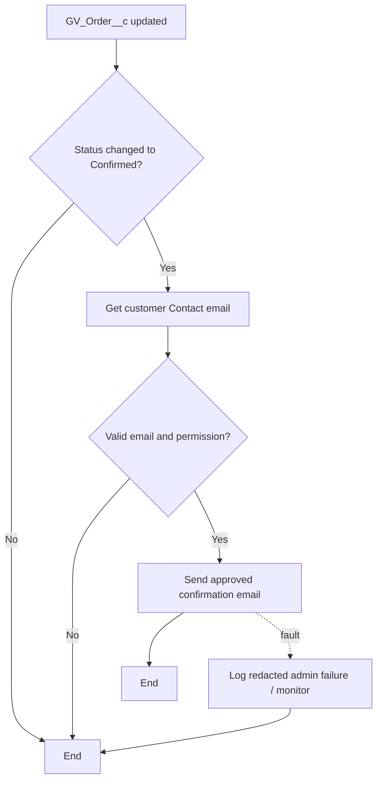

# 05 — Salesforce Flow Documentation and Automation Inventory

**GV-DOC-05 | v1.0 | Design only — no existing Salesforce Flows verified.** GoldVuee's MVP does **not** require any Flow for the critical shopping transaction. Apex handles payment, confirmation and stock to maintain one transactional owner and prevent duplicate execution.

## 1. Automation inventory and routing

| Name / API name | Type | Trigger and entry | Priority | Status | Why Flow or Apex? |
|---|---|---|---|---|---|
| `GV_Order_Confirmed_Notification` | After-save record-triggered Flow | `GV_Order__c` on update; `GV_Status__c` becomes `Confirmed` | P1 optional | Planned, **not deployed** | One simple email notification, not transactional logic |
| Payment verification | **Apex** `GV_PaymentService.verifyPayment` | Explicit signed-in `verifyPayment` call | P0 | Planned | Cryptographic checks + gateway callout + access control |
| Pending order creation | **Apex** `GV_CheckoutService.createPendingOrder` | Checkout submit | P0 | Planned | Atomic lines, price snapshot, stock check |
| Inventory deduction | **Apex** `GV_CheckoutService.confirmCapturedPayment` | Verified captured payment | P0 | Planned | Row locks, idempotency, DB transaction |
| `GV_Low_Stock_Alert` | Scheduled-triggered Flow | Future inventory threshold evaluation | P2 | Backlog | Non-critical notification |
| `GV_B2B_Approval_Notification` | Record-triggered Flow | Future approved B2B Account transition | P2 | Backlog | Workflow notification |
| `GV_Return_Notification` | Record-triggered Flow | Future return status changes | P2 | Backlog | Only after refund/returns domain modeled |

**Do not implement** P2 flow names in the first seven days. No MVP Screen Flow, Autolaunched Flow or Scheduled Flow is needed. Customer welcome messages, login and password reset should use Salesforce native identity features. No Apex trigger is required in MVP.

## 2. Optional MVP Flow specification — `GV_Order_Confirmed_Notification`

| Attribute | Specification |
|---|---|
| Flow label | GoldVuee Order Confirmed Notification |
| Flow API name | `GV_Order_Confirmed_Notification` |
| Type | Record-Triggered Flow, After Save, Actions and Related Records |
| Object | `GV_Order__c` |
| Run when | On update only; **only when status changes to** `Confirmed` |
| Entry condition | `GV_Status__c = Confirmed`, updated record meets conditions **only when moving into Confirmed**; if platform criterion is insufficient, use a Decision comparing `$Record__Prior.GV_Status__c` with `$Record.GV_Status__c` |
| Execution order | After Apex transaction commits updated order, Flow runs within platform transaction lifecycle; do not use it for stock mutation, gateway verification, or parent status rewrites |
| Record retrieval | Get related `Contact` through `GV_Order__c.GV_Contact__c` only if necessary for a permitted email destination; check field access and avoid querying other customer records |
| Decision branches | `HasEmail`: recipient email present → send; missing → terminate gracefully |
| Action | Email Alert or Salesforce Send Email using approved template including order number only and a safe link to My Orders; no delivery address/payment details |
| Fault path | Route failed email action to admin notification/monitoring; do not roll back a successful payment or retry payment/inventory |
| Duplicate prevention | Entry transition-only + store no independent confirmation emails if not required; optional email-log marker P2 if exactly-once email delivery becomes necessary |
| Permissions | Flow runs in configured context; review security context and email access; avoid logging/reading fields not required for email |
| Priority | P1; ship only after P0 tests pass |
| Test class / manual | TC-36 transition once; TC-37 repeat update does not notify; TC-38 missing email/fault path |

### Logical element path

### Activation checklist

1. Create email template with a neutral subject, order number and link. Verify external-user deliverability and sender settings.
2. Implement Flow using **exact API name** and condition; reference `$Record.Id`, `$Record.GV_Status__c`, `$Record__Prior.GV_Status__c`.
3. Verify a payment is **already** confirmed by Apex before notification. The Flow must never move an order into Confirmed.
4. Create tests: Pending→Confirmed sends once; Confirmed→Processing sends zero; Confirmed edited without transition sends zero; guest cannot execute Flow by creating/updating Orders.
5. Activate only after integration tests and email deliverability checks. Record Flow version and activate/deactivate status in development log.

## 3. Execution order and conflict prevention

1. UI requests verification through customer Apex. `GV_PaymentService` authenticates signature/provider state.
2. `GV_CheckoutService` acquires locks and updates `GV_Payment__c`, `GV_Inventory__c` and `GV_Order__c` in one Salesforce transaction.
3. Upon `GV_Status__c` transitioning to `Confirmed`, the **optional** Flow performs only notification. It does not update Payment, Inventory or Order totals.
4. LWC obtains result from Apex and displays order confirmation; independent delayed email is a convenience, not proof of payment.

**Anti-patterns to reject:** one Flow on Payment writes Order, another Flow on Order writes Inventory, and a trigger on Inventory writes Payment. Such loops create double-deduction and non-deterministic execution. Keep transactional order in **one domain service**.

## 4. Post-MVP Flow candidates: defined but intentionally not deployed

| Flow | Trigger | Proposed branch/fault and test |
|---|---|---|
| `GV_Low_Stock_Alert` | Scheduled daily on Inventory where `GV_On_Hand__c <= GV_Reorder_Level__c`; actually use `<` or `<=` based on agreed business policy | Email internal inventory manager; debounce repeats using future alert marker; test at/above threshold, null email, fault |
| `GV_B2B_Approval_Notification` | Account `GV_B2B_Status__c` changes `Pending→Approved` | Notify assigned business contact; no automatic grant of data access without licensing checks; negative test rejected account |
| `GV_Return_Notification` | Future return domain status changes | Send notification only after trusted refund service commits; no stock increment in Flow; duplicate and failed-email tests |

No scheduled flows for stock reservation, automated refund, order status, or payment verification are part of MVP. Those are either post-MVP Apex services or administrative process improvements requiring new design decisions.

## 5. Flow testing record

| Test ID | Flow | Preconditions | Steps | Expected | Actual | Status |
|---|---|---|---|---|---|---|
| TC-36 | `GV_Order_Confirmed_Notification` | Flow active, customer has email | Transition Pending Payment→Confirmed via verified payment mock | One email request; stock handled only in Apex | Not run | Pending |
| TC-37 | Same | Existing Confirmed order | Modify non-status field or Confirmed→Processing | Zero additional confirmation emails | Not run | Pending |
| TC-38 | Same | Missing email / injected email fault | Trigger eligible transition | Order remains confirmed, failure logged safely | Not run | Pending |

Tests planned here are consolidated in [11_TESTING_DOCUMENTATION.md](11_TESTING_DOCUMENTATION.md). Keep Flow metadata in `force-app/main/default/flows/`, email templates in relevant metadata directory; no Flow screenshots are evidence of successful execution.

---
[Source of truth](02_SYSTEM_ARCHITECTURE.md) · [Apex ownership](06_APEX_DOCUMENTATION.md) · [Roadmap](10_IMPLEMENTATION_ROADMAP.md)