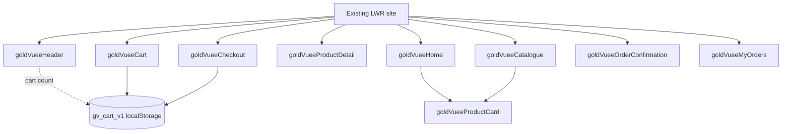

# 07 — Lightning Web Component Architecture

**GV-DOC-07 | v1.0 | Planned LWC and UI contracts.** This inventory is purposefully small. Native Experience Cloud login/registration, password reset, simple About/Contact/FAQ/legal pages and employee standard Lightning record pages do **not** get custom LWCs unless testing shows a real need. Component names are controlled by [Doc 02](02_SYSTEM_ARCHITECTURE.md).

## 1. Component inventory

| LWC | Priority | Parent/page | Apex method(s) | Data objects |
|---|---|---|---|---|
| `goldVueeHeader` | P0 | Site shared header | `GV_CatalogueController.getCategories` | `GV_Category__c` |
| `goldVueeHome` | P0 | `/` | `GV_CatalogueController.getProducts` | Product2, PricebookEntry, Category |
| `goldVueeCatalogue` | P0 | `/collection/:audience`, `/category/:slug`, `/search` | `getCategories`, `getProducts` | Product2, Category, PricebookEntry |
| `goldVueeProductCard` | P0 | Home/Catalogue child | no direct Apex | Parent `ProductCardDTO` |
| `goldVueeProductDetail` | P0 | `/product/:productId` | `getProduct` | Product2, Retail Pricebook, CMS |
| `goldVueeCart` | P0 | `/cart` | none until checkout | browser `gv_cart_v1` only |
| `goldVueeCheckout` | P0 | `/checkout` | `GV_CheckoutController.createPendingOrder`; `GV_PaymentController.startPayment`, `verifyPayment` | Order, Order Item, Payment, Inventory via Apex |
| `goldVueeOrderConfirmation` | P0 | `/order-result/:orderId` | `GV_OrderController.getMyOrder` | Own Order/Items DTO |
| `goldVueeMyOrders` | P0 | `/my-orders` | `getMyOrders`, `getMyOrder` | Own Order/Items DTO |
| `goldVueeProfile` | P1 | `/my-profile` | Native/LDS if secure | Own Contact/User supported fields |
| `goldVueeWishlist` | P2 | `/wishlist` | Future new secure service | `GV_Wishlist_Item__c` |

**Naming:** component bundle folder is exactly the camelCase name; exposed LWC HTML tag is hyphenated accordingly (for example `c-gold-vuee-checkout`). The static HTML/CSS/JS per component is built in its bundle; no custom global framework required.

## 2. Component specifications

### `goldVueeHeader`

- **HTML:** brand logo, horizontal Men/Women/Kids navigation, mobile menu toggle, account/login, cart badge; semantic `<nav>` and skip link.
- **JS:** fetch active categories; route audience links; detect user auth state; subscribe to cart-change custom event. Fallback to three static collection labels only if category query is temporarily failing, but not static category lists.
- **CSS:** premium light nav, sticky/scroll behavior, 44px minimum touch targets, mobile drawer; focus visible.
- **Events:** listens for `cartchanged` and emits `menutoggled`; no private Apex calls for guests.
- **Failure:** show categories unavailable label while keeping brand/navigation accessible; menu remains keyboard-operable.
- **Tests:** TC-01, TC-03, TC-33, TC-34.

### `goldVueeHome`

- **HTML:** brand hero, collection cards for Men/Women/Kids, featured products in reusable `goldVueeProductCard` child, trust/info banners, footer authored in Experience Builder.
- **JS:** `getProducts` with featured filter only if added to canonical controller method in a future version; **MVP recommended:** display first 8 newest published products with `sortBy=Newest`, rather than silently invent an undocumented controller parameter.
- **CSS:** luxury editorial whitespace, responsive 4/2/1 card grid, fixed image aspect ratio, above-fold CTA.
- **Apex/data:** `GV_CatalogueController.getProducts`; CMS image keys in result.
- **States/tests:** hero + skeleton, empty catalogue, API failure; TC-01, TC-05, TC-33.

### `goldVueeCatalogue`

- **HTML:** audience title, category chips/sidebar, search input, sort dropdown, product grid and previous/next pagination; uses `goldVueeProductCard` children.
- **JS:** validate audience from route (Men/Women/Kids); resolve category slug to Id by `getCategories`, call `getProducts(audience,categoryId,searchText,sortBy,pageNumber)`; debounce text input locally; reset page on filter change.
- **CSS:** tablet two-column filters/grid, mobile horizontal category chips, no overflow.
- **Data:** only published/active DTO returned by Apex; page size max 24.
- **Events:** child `addtocart`, `productopen`; parent updates `gv_cart_v1` and routes as needed.
- **States:** loading skeleton, no products (clear filters), invalid slug (not found), API error retry.
- **Tests:** TC-03–08, TC-11, TC-33.

### `goldVueeProductCard`

- **HTML:** image with meaningful alt, product title, INR price, stock status, view details and add-to-cart action.
- **JS:** accepts `@api product` DTO, no direct SOQL or callout; emits `productopen` and `addtocart` custom events with product ID only.
- **CSS:** consistent 1:1 or 4:5 image tile, subtle border/shadow, visible focus, truncation with accessible full text.
- **Tests:** shows out-of-stock disabled button, null image placeholder, keyboard interaction, no client price trust (TC-05, TC-11).

### `goldVueeProductDetail`

- **HTML:** gallery hero, name, description, material/weight, INR unit price, in-stock label, qty selector, add to cart; breadcrumb.
- **JS:** read product ID from route, call `getProduct`; clamp chosen quantity to 1–10, not beyond locally known stock boolean; checkout later revalidates true quantity.
- **CSS:** gallery/detail columns on desktop, stack on mobile; ensure image width doesn't cause horizontal scroll.
- **States:** unknown/unpublished product shows 404-like no-details state; placeholder for broken image; disabled purchase if out of stock; TC-05–07, TC-12.

### `goldVueeCart`

- **HTML:** each item image/name, numeric quantity, remove button, provisional subtotal (label **Estimated**, may change at checkout), checkout CTA.
- **JS:** `localStorage['gv_cart_v1'] = [{productId,quantity}]` **only** (no price, personal address, payment data or ContactId). Validate JSON shape/size on every read; drop malformed entries. Guest/cart survives page reload on same browser only; customer cart is not synchronized server-side in MVP. Changes dispatch a `cartchanged` event. Do not put payment/order data in localStorage.
- **CSS:** two-column list/summary on desktop, stacked items on small screens.
- **Navigation:** checkout requires native login; after login preserve cart then recheck each product with server.
- **States:** empty cart CTA, quantity invalid, stale product, JSON corruption, estimate updated; TC-11–13.

### `goldVueeCheckout`

- **HTML:** order line review, shipping form (recipient, phone, address, city, state, postal code, India), confirmed server subtotal/tax/shipping/total, a clear test-payment button and error/retry panel.
- **JS flow:** read only product IDs/qty from local cart; submit `checkoutJson` to `createPendingOrder`; show **server** amount; obtain confirmation to pay; call `startPayment(orderId)`; load Razorpay Standard Checkout in approved LWR/CSP-supported way; handle callback by calling `verifyPayment` with orderId + attemptId + paymentId + signature; only navigate to confirmation if server returns Confirmed. Browser cancel or Razorpay failure leaves order pending with retry. Any pricing change requires explicit reacceptance of new total before `startPayment`.
- **Provider script:** load the approved Razorpay checkout script according to vendor/platform CSP policy; verify in LWR sandbox. Never inject arbitrary `innerHTML` or disable CSP; public `razorpayKeyId` is allowed, `key_secret` is not.
- **Errors:** clear inline validation; loader during each transaction; no duplicate click while pending; error codes per Doc 06; insufficient stock offers return to cart; `Payment Review` shows support-only state rather than "success".
- **Tests:** TC-13–28 and end-to-end TC-35; specifically two-click submit and browser refresh while pending.

### `goldVueeOrderConfirmation`

- **HTML:** server-fetched order reference and state (Confirmed/Payment Review/Pending Payment), sanitized line summary and Back to shopping/My Orders links.
- **JS:** calls `GV_OrderController.getMyOrder(orderId)` on navigation, never uses query-string status or browser callback as proof. Only clear `gv_cart_v1` on server-confirmed success; retain cart for Failed/Review until user resolves.
- **CSS/states:** status icon and accessible text; loading, order not found, expired session, review state. **Tests:** TC-21, TC-29, TC-30.

### `goldVueeMyOrders`

- **HTML:** own order list/status badges (text, not color alone), order number/date/total, expandable line items/details.
- **JS:** call `getMyOrders()`, then `getMyOrder(id)` when needed; no customer/user ID parameter; pagination later if order history grows.
- **States:** no orders, error retry, stale status refresh, unauthorized record request. **Tests:** TC-29, TC-30.

### `goldVueeProfile` — P1 only

Native user/profile settings or secure LDS form displaying **own** supported Contact fields. Do not bypass Contact sharing; if shared Account design makes peer Contacts available, block this page until security is corrected. **Tests:** own edit succeeds, peer edit denied, validation.

### `goldVueeWishlist` — P2 only

One wishlist per Contact via `GV_Wishlist_Item__c`, duplicate composite key and ID-scoped service. Not developed within MVP; unlike cart it requires authentication and persistent server records.

## 3. Component tree and state ownership



**Event contract:** `addtocart` detail `{productId, quantity}`; `cartchanged` detail `{count}`; `productopen` detail `{productId}`. All events contain only IDs and quantities. No shared cross-page LWC runtime state guarantee; persistent browser key is the state bridge and is validated before use. On logout clear optional user-specific UI caches, not necessarily anonymous cart; never persist customer data.

## 4. LWC folder structure

```text
force-app/main/default/lwc/
  goldVueeHeader/
  goldVueeHome/
  goldVueeCatalogue/
  goldVueeProductCard/
  goldVueeProductDetail/
  goldVueeCart/
  goldVueeCheckout/
  goldVueeOrderConfirmation/
  goldVueeMyOrders/
  # goldVueeProfile/ (P1, create after P0)
  # goldVueeWishlist/ (P2, do not create in MVP)
```

Each bundle should contain `.html`, `.js`, `.css` where needed, `.js-meta.xml`, and Jest test file(s) where test tooling supports it. Expose appropriate LWR page targets using `.js-meta.xml`; route/page binding in Experience Builder is version-dependent and must be tested against this site.

## 5. Client-side validation and accessibility checklist

- Error/help text bound to inputs, invalid phone/postal code and required address fields marked; never use color alone for error/success.
- Skeletons and loading flags prevent double submits; recover from network loss or page reload by looking up own server order, not local "paymentSucceeded" state.
- Images have alt text and lazy loading where appropriate; use optimized CMS renditions and consistent dimensions to avoid layout shifts.
- Keyboard activation on navigation and cart buttons; high contrast, visible focus, logical tab order and accessible dialogs for provider checkout.
- Mobile acceptance at 375px; desktop at 1440px; test on real Experience site, not only local previews.
- Never build arbitrary query strings or inject HTML from `Product2.Description`; render as text or vetted formatted content.

## 6. LWC test plan summary

| Test IDs | Component focus | Evidence |
|---|---|---|
| TC-01–08 | Header, Home, Catalogue, ProductCard, Detail | Anonymous screenshots and network response audit |
| TC-11–13 | Cart, Checkout | Empty/invalid cart, quantity changes, refresh, auth redirect |
| TC-17–24 | Checkout/Confirmation | Two-phase server order and payment state, forged/failure cases |
| TC-29–30 | MyOrders/Confirmation | Own order vs tampered URL |
| TC-33–34 | Entire site | Responsive a11y scan, keyboard, CSP/console log review |
| TC-35 | All P0 | Complete filmed/manual demo with Salesforce record evidence |

---
[UI design](09_UI_UX_DESIGN.md) · [Apex](06_APEX_DOCUMENTATION.md) · [Tests](11_TESTING_DOCUMENTATION.md)