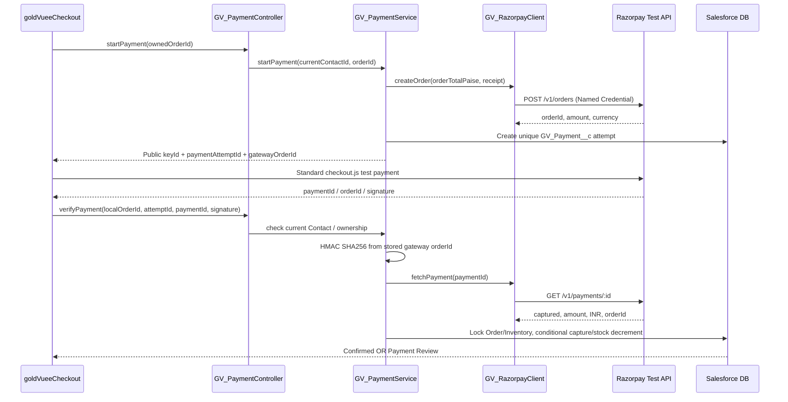

# 08 — Integration Architecture: Razorpay Test Mode and Salesforce APIs

**GV-DOC-08 | v1.0 | Integration contract, not evidence of a connected Razorpay account.** Use Razorpay **test mode only** for the seven-day MVP. Never turn on live payment collection using this document alone.

## 1. Contract and responsibilities

| Interaction | Caller → receiver | Endpoint / method | Authentication | P0? |
|---|---|---|---|---|
| Create pending Salesforce order | LWC → Apex | `GV_CheckoutController.createPendingOrder(checkoutJson)` | Authenticated Experience Cloud user | Yes |
| Start gateway attempt | LWC → Apex | `GV_PaymentController.startPayment(orderId)` | Authenticated owner, server confirms pending state | Yes |
| Create Razorpay order | Salesforce → Razorpay | `POST /v1/orders` | Named Credential `GV_Razorpay_Test`, External Credential `GV_Razorpay_Test_Auth`, Basic key id/secret | Yes |
| Launch Razorpay checkout | LWC → Razorpay script | Razorpay Standard Checkout | **Public** test `key_id`, short-lived gateway order Id | Yes |
| Report Razorpay callback for verification | LWC → Apex | `GV_PaymentController.verifyPayment(orderId, paymentAttemptId, razorpayPaymentId, razorpaySignature)` | Authenticated owner + HMAC verification | Yes |
| Fetch authoritative payment | Salesforce → Razorpay | `GET /v1/payments/{id}` | Same Named Credential | Yes |
| Webhook ingest | Razorpay → Salesforce | **No endpoint deployed in MVP**; proposed P2 `POST /services/apexrest/gv/razorpay/webhook` | Raw-body HMAC + idempotency | P2 |
| Refund capture / reconciliation | Salesforce → Razorpay | P2 authenticated refund APIs / provider reports | Admin-only service | P2 |

**Why no custom Salesforce REST endpoint in MVP?** An unauthenticated public webhook receiver introduces a distinct attack surface. For MVP, verification is initiated only by the logged-in purchaser and includes an authenticated Razorpay fetch. The consequence is that **closed tabs/abandoned payments may remain Pending Payment** until manually checked. This limitation must be demonstrated/documented; production requires webhooks + reconciliation.

## 2. Configuration, one dependency at a time

1. Confirm Razorpay test credentials exist **and test-mode automatic capture is enabled/configured as intended**, because an `authorized` payment is not yet a confirmed purchase; do not send values in ChatGPT, commits, screenshots or email. Record only the last 4 masked characters in private operator evidence if necessary.
2. Configure **External Credential** `GV_Razorpay_Test_Auth` with Basic authentication and a **Named Principal** holding test key ID (username) and test secret (password). Assign principal access only to the permitted payment service execution principal/license. Ensure credentials are hydrated in each target org after deploy (secret values are not source metadata).
3. Configure **Named Credential** `GV_Razorpay_Test` with `https://api.razorpay.com` as endpoint, linked to External Credential, auto authorization header and restricted use. Do not hardcode Basic header in Apex.
4. Confirm Salesforce named callout endpoint `callout:GV_Razorpay_Test/v1/orders` works with a mocked test first, then a controlled Razorpay test request.
5. Add only Razorpay checkout script/frame endpoints required for the actual integration in Experience Builder's CSP trusted settings; validate third-party code under Lightning Web Security. Never globally relax security/CSP for convenience.
6. **HMAC test secret gate (critical):** outbound Named Credential credentials are **not a general-purpose Apex API to read back secret bytes**. Razorpay callback signing requires `key_secret` in server-side Apex to calculate HMAC. For this non-production student demo, use a separately provisioned **org-only secret** stored in an admin-restricted encrypted secret record or restricted custom setting with explicit audit, never deployed via metadata or exported to Git, and accessible only to narrow verification Apex. Salesforce documents the limits of such mechanisms: a normal unmanaged custom metadata/custom setting is **not protected like managed-package protected metadata**. Treat this as a **test-only compromise** and a production blocker. If access controls cannot be verified, do not mark signed payment verification complete; do not silently skip HMAC.
7. Keep nonsecret `razorpayKeyId` (public test ID) in response to browser, while the key secret and webhook secret remain server-only. Test that debug logs, JS bundles, LWC requests and repo contain no secret.

**Safer production path:** obtain a supported, audited secrets/HMAC strategy (for example a correctly packaged protected configuration or enterprise-grade secret design approved for this org) with hardened webhook ingress and reconciliation. Do **not** infer that a plain custom metadata record or encrypted field by itself is sufficient for live-payment production security.

## 3. Gateway creation and verification protocol

### Phase A: local pending order

`createPendingOrder` uses trusted PricebookEntry data, validates quantities and stock, stores immutable order/line totals and shipping address. There is **no** gateway attempt yet; order `GV_Status__c = Pending Payment`.

### Phase B: start one Razorpay payment attempt

`startPayment(orderId)`:

- Identify current `User.ContactId` and verify it owns the Pending Payment order.
- Read persisted total (not client value), calculate positive integer paise; `5000.00 INR → 500000 paise`.
- Call `POST /v1/orders`, using JSON `{ "amount": 500000, "currency": "INR", "receipt": "<sanitized internal order number>" }` and no sensitive PII in `notes`.
- Validate returned gateway Id/currency/amount; insert `GV_Payment__c` attempt (`Created`, amount, currency and unique Razorpay order Id), and return `PaymentStartDTO` (`paymentAttemptId`, `razorpayOrderId`, **public** `razorpayKeyId`, `amountPaise`, `currency`).
- If callout fails: return `GATEWAY_UNAVAILABLE`, leave local order pending, no fake attempt. If local DML fails after external order creation: log **redacted** reconciliation reference, do not claim success; create new gateway order on retry as required by current Razorpay rules.

### Phase C: browser checkout

Checkout uses returned test key and **server-created** Razorpay order ID. Browser success callback delivers `razorpay_payment_id`, `razorpay_order_id` and `razorpay_signature`. Treat these as **claims** to verify, not as success. **Do not trust browser-supplied `razorpay_order_id`**; server reads persisted `GV_Payment__c.GV_Razorpay_Order_Id__c` linked to the owned attempt.

### Phase D: signed and provider-authoritative verification

`verifyPayment(orderId, paymentAttemptId, razorpayPaymentId, razorpaySignature)`:

1. Deny guest. Resolve current Contact; query **matching** Order/Attempt and Pending Payment or already Confirmed state. Never accept arbitrary account/contact/amount from browser.
2. Derive signature message from **stored** Razorpay Order ID and callback `paymentId`: `razorpay_order_id + '|' + razorpay_payment_id`.
3. Calculate HMAC SHA-256 with the securely provisioned **test key secret**, compare to supplied signature without leaking expected MAC. Mismatch → `PAYMENT_VERIFICATION_FAILED`, no stock/order update.
4. Before DML, call authenticated `GET /v1/payments/{id}`; require exact matching `order_id`, `status='captured'`, `currency='INR'`, and amount in paise equal to persisted order and attempt totals. `authorized`, `created`, `failed`, partial or mismatched data is **not captured success**.
5. Invoke `GV_CheckoutService.confirmCapturedPayment`, which locks Order + Inventory and atomically stores unique Payment ID, marks attempt Captured, decrements stock **once**, moves Order to Confirmed; or enters Payment Review if stock ran out after capture.
6. Return only `PaymentResultDTO` status; LWC queries own Order again before displaying confirmation and clears cart only if confirmed.

**Retry rule:** failed checkout and later retry should create **a new gateway order/attempt**. Leave previous `GV_Payment__c` as Failed or unresolved until reconciled; never reuse old payment token or skip uniqueness checks.

## 4. Payment sequence diagram

## 5. Webhooks (P2 plan, not MVP implementation)

Planned `GV_RazorpayWebhookHandler` Apex REST class (P2 only) with `/services/apexrest/gv/razorpay/webhook` endpoint when a secure public site REST entry point and access restrictions are verified. Create **separate** webhook secret from API key secret. Validate `X-Razorpay-Signature` HMAC-SHA256 over the **raw unmodified request body**, not re-serialized JSON. Keep limited source data, event ID and event state, and add a future `GV_Webhook_Event__c` unique event-ID record (P2, defined when actually building) to deduplicate events. Handle `payment.captured`, `payment.failed`, and `order.paid` without double confirmation; handle out-of-order/older events without regressing captured state. Process asynchronously only after safe inbound validation; add a reconciliation job for dropped webhooks and pending orders. If Salesforce public REST security cannot be guaranteed, do not expose endpoint.

**Webhook must not:** blindly trust `order.paid`, create paid orders from unknown IDs, update stock twice, bypass amount/currency checks, leak payloads, or process failed events after confirmed capture as reversals.

## 6. Failure, concurrency and reconciliation table

| Scenario | Data state | Required handling | Test |
|---|---|---|---|
| Gateway create timeout | Local order Pending Payment, no attempt | Safe retry; no confirmed order | TC-19 |
| Customer closes payment popup | Pending Payment / Created attempt | Show pending, optionally new attempt; no deduction | TC-23 |
| Razorpay payment failed | Attempt Failed or remains Created pending reconciliation | No stock update; retry starts new attempt | TC-21 |
| Signature invalid | No state mutation | Generic verification failure and security monitoring | TC-22 |
| Payment authorized but not captured | Pending Payment, no stock deduction | Wait/retry status check; never fulfill | TC-23 |
| Amount/order/currency mismatch | Pending Payment, attempt Review | No confirmation; admin investigation | TC-24 |
| Captured success | Payment Captured; Order Confirmed; stock reduced | Single atomic transaction | TC-25 |
| Replay same paymentId/signature | No changes | Idempotent already-confirmed response | TC-26 |
| Two paid requests compete for last SKU | Lock/serialize stock records | At most available qty sold; other captured payment enters Payment Review | TC-28 |
| Captured but stock unavailable | Order Payment Review; Payment Captured | No negative stock, manual test reconciliation | TC-27 |
| Browser shows fake success | Server sees no trusted capture | No confirmation; no stock mutation | TC-22 |

## 7. Salesforce internal API, request/response contracts

| Call | Request | Response / validation |
|---|---|---|
| `getProducts` | audience/categoryId/searchText/sortBy/pageNumber | Public DTO only; published/active filtering; no Inventory quantity |
| `createPendingOrder` | JSON lines+address only | Order Id and **server** totals; rejects any client price/ContactId fields |
| `startPayment` | Order Id | Registered attempt, public test key, gateway order Id and paise |
| `verifyPayment` | Order Id, attempt Id, payment Id, signature | `Confirmed`, `Payment Review`, or failure; no raw provider response |
| `getMyOrders` | none | Own order summaries only |
| `getMyOrder` | Order Id | Own order/line snapshots; generic not-found/forbidden otherwise |

No custom public Salesforce REST API is required for customer checkout; LWC calls secured `@AuraEnabled` Apex controllers. Metadata APIs and Salesforce CLI are deployment tools, **not anonymous application endpoints**. A future mobile/API client requires a separate Connected App/OAuth architecture, not reuse of guest web access.

## 8. Platform and vendor documentation

- Razorpay Standard Checkout and verification: https://razorpay.com/docs/payments/payment-gateway/web-integration/standard/integration-steps/
- Razorpay Orders API: https://razorpay.com/docs/api/orders/
- Razorpay Payments API: https://razorpay.com/docs/api/payments/
- Razorpay webhook verification: https://razorpay.com/docs/webhooks/validate-test/
- Salesforce Named Credential integration: https://developer.salesforce.com/docs/platform/apex-dev/references/apex-dev/apex-callouts-named-credentials.html
- Salesforce secret storage caveats: https://developer.salesforce.com/docs/platform/secure-coding/guide/secure-coding-storing-sensitive-data.html
- LWR CSP/LWS: https://developer.salesforce.com/docs/platform/communities-dev/guide/communities-dev-security-locker-csp.html

**Production non-goal:** a working test payment does not establish PCI scope clearance, GST/tax compliance, live gateway settlement correctness, refund automation or commercial production readiness.

---
[Source of truth](02_SYSTEM_ARCHITECTURE.md) · [Apex](06_APEX_DOCUMENTATION.md) · [Testing](11_TESTING_DOCUMENTATION.md)