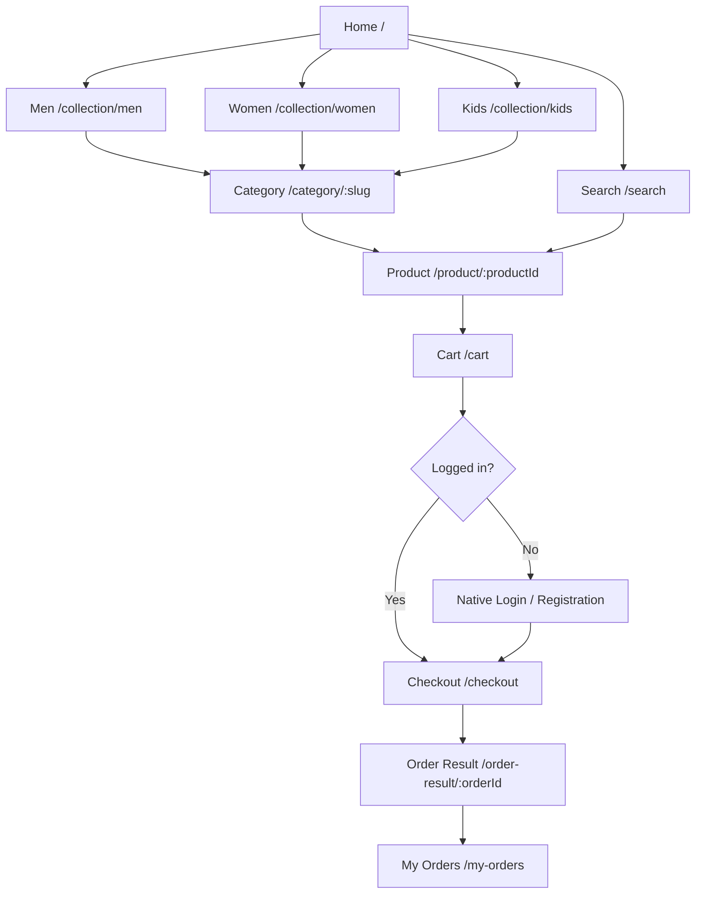

# 09 — GoldVuee UI/UX Design Specification

**GV-DOC-09 | v1.0 | Proposed experience; not proof pages have been built.** Implement in the existing GoldVuee **Experience Cloud LWR** site. Brand is premium, calm and accessible; luxury is a visual style, not a reason to sacrifice legibility.

## 1. Navigation and page inventory



### Public page specifications

| Route/page | MVP | UI content | Owner |
|---|---|---|---|
| `/` Home | P0 | Hero, collection cards, latest products, featured brand narrative | `goldVueeHome` + Experience Builder |
| `/collection/men` | P0 | Men's catalogue, 5 dynamic categories | `goldVueeCatalogue` |
| `/collection/women` | P0 | Women's catalogue, 5 dynamic categories | Same component |
| `/collection/kids` | P0 | Kids' catalogue, 5 dynamic categories | Same component |
| `/category/:slug` | P0 | Collection/category filtered listing | Same component, slug resolved via `GV_Category__c` |
| `/product/:productId` | P0 | Image gallery/primary image, name, price, specs, availability, CTA | `goldVueeProductDetail` |
| `/search` | P0 | Search query, filtered results, empty states | `goldVueeCatalogue` |
| `/about`, `/contact` | P1 | Brand overview, non-sensitive contact information | Experience Builder static content |
| `/faq`, `/privacy`, `/terms`, `/shipping-returns` | P1 | Clearly marked **demo** policies, not invented real-company legal statements | Experience Builder static content; external legal approval before live use |

### Customer page specifications

| Route/page | MVP | UI content | Owner |
|---|---|---|---|
| Native Login, Registration, Forgot Password | P0 | Salesforce standard identity and reset pages | Experience Cloud settings |
| `/cart` | P0 | Item list, qty, remove, estimated subtotal | `goldVueeCart` |
| `/checkout` | P0 | Shipping form, authoritative amount, Razorpay test | `goldVueeCheckout` |
| `/order-result/:orderId` | P0 | Confirmed/Review/Pending server state, never inferred from URL | `goldVueeOrderConfirmation` |
| `/my-orders` | P0 | Customer-owned order history/details | `goldVueeMyOrders` |
| `/my-profile` | P1 | Own profile fields, native where possible | `goldVueeProfile` optional |
| `/wishlist` | P2 | Persistent own wishlist | `goldVueeWishlist` future |
| Customer dashboard/address book | P2 | Orders, saved addresses, preferences | Future component decision |

**Route syntax** is a design convention; configure actual LWR route mappings and verify supported navigation behavior in Experience Builder. Do not assume Lightning Record Page URLs are public site routes.

## 2. Information architecture and collections

Exactly three top-level audience collections: **Men, Women, Kids**. No top-level Gifts/Bridal/Sale until user-approved future expansion. Five dynamic categories for each collection (source of truth: `GV_Category__c`, see [03](03_DATA_MODEL.md)). Each Product2 has exactly one chosen category and a matching audience for MVP; future multi-category merchandising would require a junction object and migration, not an untracked JSON field.

Nav hierarchy: `Home > Women > Rings > GoldVuee Classic Ring`. Show breadcrumbs on detail and filtered listings. Search operates on public published names/descriptions only. Empty search message includes clear filters and return-to-all-products action.

## 3. Design system

| Token | Proposed value | Use |
|---|---|---|
| `--gv-ink` | `#24211D` | Primary text |
| `--gv-gold` | `#A27C3C` | Accent, selected states, subtle rules; test contrast on white |
| `--gv-cream` | `#F8F5EF` | Page backgrounds |
| `--gv-paper` | `#FFFFFF` | Card surfaces |
| `--gv-muted` | `#665F54` | Secondary text with verified WCAG contrast |
| `--gv-danger` | `#A52828` | Error states (with icon/text) |
| `--gv-outline` | `#D8D1C5` | Borders/dividers |
| Serif display | Georgia or licensed brand serif | Hero/major headings only |
| Sans body | System/Arial/approved accessible sans | Body, prices, forms, navigation |
| Spacing scale | `4, 8, 12, 16, 24, 32, 48, 64px` | Consistent layout |
| Breakpoints | 480px / 768px / 1024px | Responsive grid and nav |

Gold is decorative and cannot be the only indication of selection or stock error. Use adequate contrast for price, links, CTA and focus. CMS imagery should preserve product color/material truth; no watermarked placeholder for public launch. `Product2.GV_Image_Key__c` maps to CMS public media; use a branded static asset placeholder for failure states if license/CMS support needs remediation.

## 4. Screen structure sketches (text wireframes)

**Home (desktop)**

```text
+-------------------------------------------------------------------------+
| GoldVuee    Men    Women    Kids   Search             Login   Cart (2) |
+-------------------------------------------------------------------------+
|       JEWELLERY FOR EVERY STORY      [Explore Collection]               |
|       Premium editorial hero + licensed product photograph              |
+------------------+------------------+--------------------+-------------+
| Men collection   | Women collection | Kids collection    |             |
+------------------+------------------+--------------------+-------------+
| Latest Jewellery                                                       |
| [image price]  [image price]  [image price]  [image price]              |
+-------------------------------------------------------------------------+
| About / Contact / FAQ / Terms / Privacy / Shipping & Returns            |
+-------------------------------------------------------------------------+
```

**Category/Product:** breadcrumb → filters/chips → grid of image cards → product detail gallery and description → available price → quantity → Add to cart. **Checkout:** cart summary → shipping address → authoritative totals → clearly labelled **Pay with Razorpay (Test Mode)** → server-confirmed result; never use "payment successful" if verification failed.

## 5. User journey, errors and edge cases

| Step | Happy path | Failure/empty handling |
|---|---|---|
| Discover | Guest opens published site and collection | Missing image uses branded placeholder; invalid category returns not found |
| Browse | Filter/search published catalog | Zero products → suggest clearing filters; show loading skeleton |
| Cart | Item selected, qty updated, estimate refreshed | Invalid JSON cart discarded safely; out-of-stock cannot proceed |
| Login | Native auth, returns to cart/checkout | Failed registration/login/reset shows native supported error; never custom password logging |
| Checkout | Server confirms product, price and shipping | Prices changed → require explicit reconfirmation; stock changed → adjust quantity |
| Payment | Test popup, signed + captured server verification | Popup close/timeout/failure → leave pending; never deduct stock |
| Confirm | Query persisted own Order `Confirmed` | Stock race after capture → `Payment Review`; show support message |
| History | Show own orders/status | 0 orders → browse CTA; tampered Id → generic not found |

Cart persistence is same-browser local-only and intentionally lacks personal/financial data. Clearing cart happens only after server confirmation; do not use browser local success flags to fake persistence.

## 6. Mobile and accessibility acceptance

- At width 375px: hamburger menu, no horizontal overflow, touch targets >=44×44 px, form fields full width, checkout summary visible before payment; checkout modal must be tested on a real mobile browser.
- At width 1440px: sensible max-width (e.g. 1200px), readable paragraph line length, clear hierarchy and fixed catalogue card proportions.
- All images have descriptive alt text; heading order H1→H2; focus indicators visible; semantic button elements; `aria-live` for errors/cart status where appropriate; labels associated with form fields.
- Keyboard journey: Men → category → product → add cart → checkout → confirmation works without trapping focus except provider-controlled modal, which must be verified.
- Use CSS tokens consistently; no hardcoded category names in JS except the three permitted collection labels for routing fallback.

## 7. Admin UI/UX — native Salesforce first

Create a Lightning app `GoldVuee Admin` (P1 if time allows) with tabs for Products, Product Categories, Inventory, Sales Orders, Payment Transactions, Contacts/Accounts and Reports according to permissions. Use standard Lightning Record Pages, Page Layouts, related lists, list views and compact layouts rather than writing custom `productManagement`, `inventoryDashboard` and `orderManagement` LWCs. Manager-facing fields and validation should be visible in the layouts; expose sensitive Payment records only to authorized staff.

**Required practical learning after Day 7:** refine Page Layouts, Lightning Record Pages/Lightning App Builder, List Views, Record Types if justified, Formula Fields, Flow Builder, Profiles/Permission Sets, Object-Level Security, Field-Level Security, Reports and Dashboards. This remains distinct from completing the payment MVP.

## 8. UI acceptance cases

TC-01 home incognito; TC-03 audience nav; TC-04 dynamic categories; TC-05 product tile/detail; TC-08 search/filter; TC-11 cart actions; TC-13 checkout redirect/validation; TC-21 payment result; TC-29 own history; TC-33 responsive; TC-34 keyboard/a11y/CSP. Evidence must be captured from the deployed Experience site, not Figma/mockups alone.

---
[Catalogue and data](03_DATA_MODEL.md) · [LWC](07_LWC_DOCUMENTATION.md) · [Testing](11_TESTING_DOCUMENTATION.md)